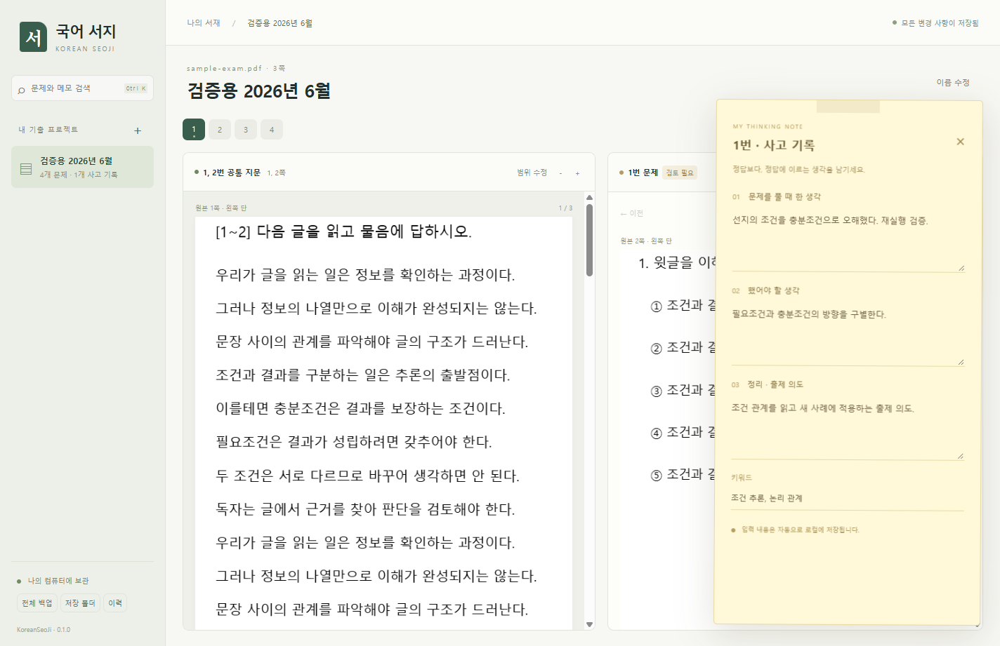

# 국어 서지 · KoreanSeoJi

국어 기출을 시험별 프로젝트로 보관하고, 문제를 풀 때의 사고와 비슷한 문제 사이의 관계를 기록하는 Windows용 로컬 학습 도구입니다.



## 실행

`KoreanSeoJi.exe`를 쓰기 가능한 폴더에 놓고 실행합니다. 프로그램 설치, Python 설치, 계정 로그인은 필요하지 않습니다. Windows 10/11 **x64**와 **Microsoft Edge WebView2 Runtime**이 필요합니다. 이 PC에서는 실행을 확인했습니다. WebView2가 없는 PC는 [Microsoft 공식 배포 페이지](https://developer.microsoft.com/en-us/microsoft-edge/webview2/)에서 Runtime을 설치해야 합니다.

첫 실행 시 실행 파일 옆에 `Data` 폴더를 만듭니다. **실행 파일만 옮기면 기존 공부 기록이 따라가지 않습니다. 다른 PC로 옮길 때는 `Data`도 함께 옮기세요.**

## 공부 흐름

1. **＋ 프로젝트**에서 `2026년 6월 모의평가`처럼 이름을 정합니다. 연도는 응시 연도·학년도 중 본인 기준으로 자유롭게 입력합니다.
2. **PDF 가져오기**로 문제 PDF를 선택합니다. 프로젝트당 PDF 하나를 보관합니다. 원본은 `Data/pdfs`에 복사되므로 가져온 뒤 원래 파일을 옮겨도 열 수 있습니다. PDF를 실행 파일에 드래그해도 새 프로젝트로 가져옵니다.
3. 문항 번호, `[4~7]` 같은 공통 지문 표제와 글자 위치를 분석합니다. 기본값은 2단 편집입니다. 스캔 페이지는 포함된 한국어·영어 OCR로 처리합니다. 인식은 인터넷 없이 진행합니다.
4. **지문은 왼쪽, 선택한 문제는 오른쪽**에 원본 모양으로 표시합니다. 지문이 다음 단이나 다음 페이지로 넘어가면 여러 영역을 순서대로 이어 표시합니다.
5. 자동 결과는 **검토 필요** 상태입니다. 원본과 비교한 뒤 **인식 범위 확인 완료**를 누릅니다. 잘못 나뉘었다면 **범위 수정**에서 드래그 → **선택 영역 추가**를 반복합니다. 페이지를 넘겨 추가할 수 있습니다. 지문을 공유할 문제 번호도 직접 정할 수 있습니다. 빠진 문항은 **＋ 문제**로 추가합니다.
6. **자세히 · 메모**를 열어 `문제를 풀 때 한 생각`, `했어야 할 생각`, `정리 · 출제 의도`, `키워드`를 적습니다. 입력 후 약 0.18초에 저장을 시작하며, 상단에서 저장 완료를 확인할 수 있습니다. 정상 종료 시 대기 중인 입력도 저장합니다.
7. **참조 연결**에서 다른 프로젝트를 포함한 문제를 검색하고 연결 이유를 적습니다. 연결 하나를 양쪽 문제에서 공유하므로 어느 쪽에서도 상대 문제로 이동합니다. 연결 해제도 양쪽에 반영됩니다. `Alt + ←`로 이동 전 문제로 돌아갈 수 있습니다.

`Ctrl + K`는 전체 문제·메모 검색, `Ctrl + S`는 즉시 저장입니다. 문제 상태는 미풀이 / 풀었음 / 다시 볼 문제 / 정리 완료로 관리합니다.

## 자동 인식의 범위

현재는 문항 번호·표제·좌표에 기반한 자동 분할입니다. 의미를 이해해 출제 의도를 판정하거나 비슷한 문제를 자동 추천하는 기능은 포함하지 않습니다. 참조는 사용자가 판단해서 연결합니다.

PDF의 편집 방식, 잘못된 글자 인코딩, 인쇄·스캔 품질, 번호처럼 보이는 본문, 그림 배치에 따라 영역이 잘못 나뉠 수 있습니다. **자동 인식이 항상 정확하다고 가정하지 않습니다.** 모든 문항은 기본적으로 검토 대상으로 표시하고 수동 보정을 제공합니다. 1단 문서는 **다시 인식 → 1단**, 글자가 깨지는 문서는 **모든 페이지 OCR**을 선택하세요. 재인식은 같은 문항 번호의 메모·참조를 유지하지만, 자동 영역은 새로 계산합니다. 수동으로 다듬은 범위는 재검토해야 합니다. 재인식에서 빠진 기존 문항도 보존합니다.

암호화된 PDF는 암호를 해제한 후 가져와야 합니다. 파일당 최대 512 MB입니다. 이번 초기 버전은 합성한 2단·여러 페이지 PDF와 스캔 PDF로 검증했으며, 실제 기출 파일별 인식 품질은 추가 확인이 필요합니다.

## 기록 보존과 백업

| 경로 | 내용 |
| --- | --- |
| `Data/library.sqlite3` | 프로젝트, 영역, 메모, 태그, 문제 상태, 양방향 참조 |
| `Data/library.sqlite3-wal`, `-shm` | 실행 중 SQLite가 사용하는 파일. 실행 중 임의로 지우지 마세요. |
| `Data/pdfs/` | 가져온 PDF 복사본 |
| `Data/backups/` | 하루 첫 실행 시의 데이터베이스 자동 백업 |
| `Data/.runtime/` | 실행 파일에서 꺼낸 화면·OCR 리소스와 WebView2 프로필. 공부 기록은 여기에 저장하지 않습니다. |

SQLite 트랜잭션과 `synchronous=FULL`을 사용하며, 최근 100개 저장 버전을 보관합니다. **이력**에서 최근 30개 버전을 골라 복원할 수 있습니다. 복원 직전 데이터도 이력에 남깁니다. 같은 `Data`를 두 프로그램이 동시에 수정하지 못하게 잠급니다. 저장 실패는 상단에 표시하고 정상 종료를 중단해 입력을 보존합니다.

**전체 백업**은 선택한 위치에 데이터베이스와 모든 PDF를 함께 복사합니다. 하루 단위 자동 백업에는 PDF가 포함되지 않으므로, 별도 디스크에 전체 백업을 주기적으로 보관하는 것이 좋습니다. 저장 장치의 손상·분실까지 단일 로컬 사본만으로 보호할 수는 없습니다.

전체 백업 복원은 프로그램을 종료한 뒤 기존 `Data`를 따로 보관하고, 백업의 `library.sqlite3`와 `pdfs`를 실행 파일 옆의 새 `Data`에 넣는 방식입니다. 자동 백업 DB를 복원할 때는 기존 `pdfs`도 함께 보존하세요. 이동·교체는 반드시 프로그램이 종료된 상태에서 합니다.

## 개발과 빌드

핵심 호스트는 C++20 / Win32이며 SQLite와 WebView2 로더를 정적으로 링크합니다. 화면은 실행 파일에 포함된 HTML/CSS/JavaScript, PDF.js, Tesseract.js로 구성합니다. Electron이나 Node 서버를 실행하지 않습니다. 빌드에 필요한 의존성은 다운로드하며, 완성된 실행 파일에는 약 25 MB의 PDF·OCR 리소스가 내장됩니다.

필요한 도구:

- Windows x64, Visual Studio 2022 Build Tools의 **Desktop development with C++** 및 Windows SDK
- CMake 3.24 이상, Python 3.12 이상
- 테스트 실행 시 Node.js, 합성 PDF 생성 시 `pymupdf`

```bat
scripts\build.cmd
```

완성 파일은 `dist/KoreanSeoJi.exe`입니다. 한글 작업 경로에서 발생하는 CMake 링크 문제를 피하기 위해 빌드 스크립트가 `%LOCALAPPDATA%/KoreanSeoJi-build`에 현재 소스 폴더를 가리키는 디렉터리 junction을 만듭니다. 소스를 이동하거나 복제하지 않습니다.

```bat
node --test tests/parser.test.mjs
dist\KoreanSeoJi.exe --self-test --data-dir "%TEMP%\KoreanSeoJi-storage-test"
python tests\make_fixture.py
python scripts\test_dependencies.py
node tests\e2e.cjs
node tests\ocr.cjs
```

저장소 자체 검사는 빈 시험용 폴더에서 실행하세요. GUI 통합 검사는 실제 실행 파일과 임시 데이터 폴더를 사용하며 외부 브라우저를 설치하지 않습니다. 빌드된 WebView2의 개발용 CDP 포트는 테스트 프로세스에만 환경변수로 켭니다.

```bat
KoreanSeoJi.exe --pdf "D:\시험지.pdf"
KoreanSeoJi.exe --data-dir "D:\별도공부폴더"
```

## GitHub 관리

소스와 빌드 절차는 [Skylark51/KoreanSeoJi](https://github.com/Skylark51/KoreanSeoJi)에서 관리합니다. 원본 기출, 개인 메모, 백업, OCR 캐시와 빌드 의존성은 `.gitignore`로 제외합니다. GitHub Actions는 Windows 실행 파일을 빌드해 portable ZIP을 빌드 산출물로 올립니다.

외부 구성 요소의 고지와 라이선스는 `THIRD_PARTY_NOTICES.md` 및 `third_party/`에 있습니다.
